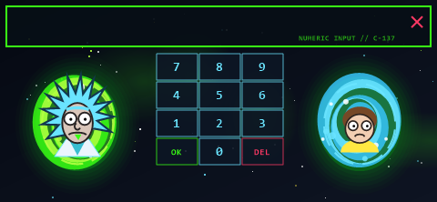

# pineapple-pager

Themes and payloads for the [Hak5 WiFi Pineapple Pager](https://hak5.org/products/wifi-pineapple-pager).


## Contents

| Path | What it is |
|---|---|
| [`themes/RickAndMorty/`](themes/RickAndMorty/) | Rick and Morty fan theme, framework 0.9, firmware 2.0.0-stable |
| [`library/user/general/theme_switcher/`](library/user/general/theme_switcher/) | Payload to preview, install and activate themes on the device |

The layout follows Hak5's own [themes](https://github.com/hak5/wifipineapplepager-themes) and [payloads](https://github.com/hak5/wifipineapplepager-payloads) repositories, so each directory copies to the Pager unchanged.

## Quick install

With the Pager connected over USB-C (default address `172.16.52.1`):

```sh
scp -r themes/RickAndMorty root@172.16.52.1:/mmc/root/themes/
scp -r library/user/general/theme_switcher root@172.16.52.1:/mmc/root/payloads/user/general/
```

Then run **Theme Switcher** from the payloads menu, pick **RickAndMorty**, and choose **Activate This Theme**.

A ready-to-extract tarball of the theme is attached to each [release](../../releases).

## Screenshots

| Boot | Keyboard | Easter egg |
|---|---|---|
|  |  |  |

## Disclaimer

**Unofficial, non-commercial fan work.** Not affiliated with, sponsored by, or endorsed by Hak5 or by the creators or rights holders of *Rick and Morty*. *Rick and Morty* and its characters, names and related elements belong to their respective owners, and no ownership of them is claimed.

Rights holders: if anything here concerns you, [open an issue](../../issues/new) and it will be removed promptly. See [NOTICE.md](NOTICE.md) for full details.

## License

[MIT](LICENSE), covering the original code and original work in this repository only. It grants no rights in third-party trademarks or characters. See [NOTICE.md](NOTICE.md).
